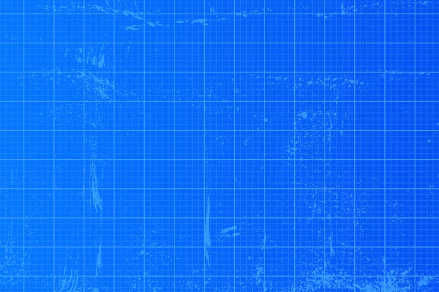

<p align="center">
  
</p>

<h1 align="center">DrawBackground</h1>

<p align="center">
  <strong>Прозрачный Excalidraw-холст поверх рабочего стола macOS через Plash.</strong>
</p>

<p align="center">
  
  
  
  
  
</p>

---

## Что это

DrawBackground — локальный проект для рисования в Excalidraw прямо в Plash. Рисунки остаются на вашем Mac: никакой публикации, аккаунтов или облака. SVG автоматически сохраняется в `work/wallpaper.svg`.

## Выбери режим

| Режим | URL | Когда использовать |
| --- | --- | --- |
| **Рисование в Plash** | `http://127.0.0.1:5173/draw.html` | Нужны инструменты Excalidraw и редактирование прямо на экране |
| **Готовый рисунок поверх рабочего стола** | `http://127.0.0.1:5173/wallpaper.html` | Нужен только результат без редактирования |
| **Обычный редактор** | `http://127.0.0.1:5173/` | Импорт SVG, проверка и работа в браузере |

### Управление кликами в Plash

- Чтобы **рисовать**, выключите в Plash `Click-through` / включите взаимодействие с веб-страницей.
- Чтобы снова пользоваться рабочим столом, включите `Click-through`.

Это два разных режима: прозрачная веб-страница не может одновременно получать мышь для рисования и пропускать её в macOS.

---

## Первый запуск

```bash
cd /Users/mykytatishkin/Documents/DrawBackground
npm install
npm run dev
```

Откройте `http://127.0.0.1:5173/`. Пока эта команда работает, сервер доступен. Для постоянного запуска после входа в macOS настройте `launchd` ниже.

---

## Автозапуск в macOS

Проект использует `launchd` — штатный механизм macOS, а не cron. Он запускает сервер после входа в ваш аккаунт и перезапускает его при сбое.

> [!NOTE]
> Сервер не работает во время выключенного или спящего Mac. Он автоматически запускается после следующего входа в macOS.

### Установка

Если вручную запущен `npm run dev`, остановите его через `Ctrl+C`. Затем:

```bash
cd /Users/mykytatishkin/Documents/DrawBackground
cp com.excalidraw-plash.server.plist ~/Library/LaunchAgents/
launchctl bootstrap gui/$(id -u) ~/Library/LaunchAgents/com.excalidraw-plash.server.plist
```

### Проверка

```bash
launchctl print gui/$(id -u)/com.excalidraw-plash.server
lsof -nP -iTCP:5173 -sTCP:LISTEN
```

Нормальный результат: `state = running` и один процесс `node`, слушающий `127.0.0.1:5173`.

### Отключение

```bash
launchctl bootout gui/$(id -u)/com.excalidraw-plash.server
rm ~/Library/LaunchAgents/com.excalidraw-plash.server.plist
```

---

## Редактирование проекта

```bash
code /Users/mykytatishkin/Documents/DrawBackground
```

| Файл | Назначение |
| --- | --- |
| `src/main.jsx` | страницы, Excalidraw и автосохранение SVG |
| `src/styles.css` | визуальный стиль и прозрачный режим Plash |
| `vite.config.js` | локальный API сохранения `work/wallpaper.svg` |
| `draw.html` | чистый прозрачный режим рисования |
| `wallpaper.html` | только показ готового SVG |
| `com.excalidraw-plash.server.plist` | автозапуск локального сервера |

После изменения `src/` Vite перезагружает страницу автоматически. Если Plash не подхватил изменение, перезагрузите wallpaper в самом Plash.

После изменения `.plist` переустановите агент:

```bash
launchctl bootout gui/$(id -u)/com.excalidraw-plash.server
cp com.excalidraw-plash.server.plist ~/Library/LaunchAgents/
launchctl bootstrap gui/$(id -u) ~/Library/LaunchAgents/com.excalidraw-plash.server.plist
```

---

## Команды проверки и диагностики

| Что проверить | Команда | Ожидаемый результат |
| --- | --- | --- |
| Установить зависимости | `npm install` | Завершается без ошибок |
| Собрать проект | `npm run build` | `built in ...` |
| Запустить вручную | `npm run dev` | URL на `127.0.0.1:5173` |
| Проверить `launchd` | `launchctl print gui/$(id -u)/com.excalidraw-plash.server` | `state = running` |
| Проверить порт | `lsof -nP -iTCP:5173 -sTCP:LISTEN` | Один `node` на порту `5173` |
| Читать обычный лог | `tail -f work/launchd.log` | Запуск Vite |
| Читать ошибки | `tail -f work/launchd-error.log` | Понятная причина, если запуск не удался |

> [!WARNING]
> Не используйте `npm run preview` для Plash: этот режим не включает API автосохранения SVG.

---

## SVG и Ghostty

### Показ старого SVG

На странице `http://127.0.0.1:5173/` нажмите **«Показать SVG»** и выберите файл. Он отобразится в `wallpaper.html`. Следующее изменение на холсте заменит его новым SVG.

### Ghostty из Finder

Ghostty уже добавляет Finder Service: выделите папку → правый клик → **Services → New Ghostty Window Here**.

Чтобы назначить сочетание: **System Settings → Keyboard → Keyboard Shortcuts → Services** → `New Ghostty Window Here`. Хороший вариант: `⌃⌥⌘T`.

---

<p align="center">
  <sub>Сделано для локального использования на macOS · рисунки остаются на вашем Mac</sub>
</p>
